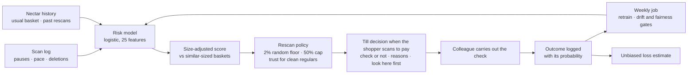

# SmartShop Loss Engine

[](https://github.com/TilakHeble/smartshop-loss-engine/actions/workflows/ci.yml) [](https://smartshop-loss-engine.streamlit.app/)

**In one sentence:** when a SmartShop shopper scans the barcode at the till to pay, this system decides whether the till asks for their basket to be checked, so the same staff time catches more loss and far fewer honest shoppers are stopped.

**The problem.** With SmartShop (scan-as-you-shop) customers scan their own items. Some items leave unscanned, a few on purpose and many by honest mistake. Today the till picks about 12% of shoppers at random for a check (a "rescan", carried out by a colleague), so most checks stop honest people and find little. This project makes that till decision from the scan log and the shopper's Nectar history instead, while keeping a small random chance for everyone, so the checks can still be measured, can't be gamed, and come with a neutral reason.

## Start here

| If you have... | Look at |
|---|---|
| **1 minute** | [The result](#the-result) below, and the [live dashboard](https://smartshop-loss-engine.streamlit.app/) |
| **5 minutes** | The [two-page business case](docs/business_case.md): the problem, the results and how to prove them in real stores |
| **20 minutes, technical** | [How it works](#how-it-works), the [model card](docs/model_card.md) (performance, fairness, data protection, limits) and the [build log](docs/build_log.md) (every step, with what went wrong) |
| **Time to run it** | [Run it](#run-it): the dashboard needs no data; everything else rebuilds from the public dunnhumby dataset |

Not sure what a term means? See the [glossary](#glossary). The full document list is in [docs/](docs/README.md).


## The result

Same colleague time as today; test period; shoppers who learn the policy and respond; trust updated over four cycles; mean of 10 runs. SmartShop behaviour is simulated on 2.35m real basket lines and calibrated to published loss research, so these figures show that the method recovers a known truth, not a forecast for Sainsbury's.

| | Today (random checks) | **Recommended policy** |
|---|---|---|
| Loss remaining | \$41,130 | **\$32,216 (−22%)** |
| Value recovered by checks | \$1,705 | **\$9,320 (5.5x)** |
| Recovered per colleague hour | \$13 | **\$70** |
| Honest shoppers stopped | 5,428 | **2,270 (−58%)** |

- **It survives being wrong.** Fourteen stress tests each change one assumption and rerun everything. Loss is 5–24% lower in every one, including a theft method the model was never designed for: barcode switching, where the scan count, pace and deletions all look normal ([v1.1](docs/build_log.md#v11-an-unseen-theft-method-and-closing-the-age-gap)).
- **It is checked for fairness properly.** Every group of honest shoppers is stopped at under half today's rate. A check that separates real gaps from small-group chance found an age gap; scoring each session against baskets of a similar size narrows it *and* catches more.
- **It covers sessions that never reach the till.** A shoplifter who scans everything, cancels and walks out behind a paying customer loses the store the whole basket, about an eighth of all loss, and no rescan sees it. A colleague prompt to help on every cancellation halves it, genuine cancellers get help, and a dead handset is resumed instead of rescanned ([v1.3](docs/build_log.md#v13-sessions-that-never-reach-the-till-cancellations-cancel-and-walk-dead-handsets)).
- **Both kinds of check are modelled as they work in store** (v1.4). A partial check covers about 20–25% of the basket and, if it finds anything unscanned, the till suggests a full check; or the till asks for a full check directly. Modelled this way today's checks catch more than earlier versions credited, so the headline above is measured against that stronger baseline. When the till *targets* a shopper, a full check beats a partial one at every mix tested, even short-staffed ([v1.4](docs/build_log.md#v14-partial-checks-that-escalate-and-full-checks)).
- **Loss stays measurable.** Averaging what targeted rescans find overstates loss about 4x; weighting each rescan by its logged probability is unbiased to within about 1%.
- **What didn't work is reported, not hidden:** targeted partial checks (full rescans recover more per colleague-minute) and in-app "did you forget?" prompts (usually wrong).

> **Important:** SmartShop data is not public, so shopper behaviour is **simulated** on real grocery baskets and checked against published loss research. The figures show the method works in that world; a store trial (designed in the [business case](docs/business_case.md#how-to-prove-it-in-real-stores)) is how it would be proven for Sainsbury's.

## How it works



1. **Score.** When the shopper scans the barcode at the till to pay, a logistic model reads the session's scan log and the member's Nectar history (no demographics, channel or time of day) and estimates the chance a rescan finds something. The score is then compared with sessions of a similar basket size, because big baskets nearly always hold an honest slip and are the slowest to rescan.
2. **Decide.** The score sets a rescan *probability* between a 2% random floor (anyone can be checked) and a 50% cap (nobody is checked every trip), lowered for regulars whose recent rescans were clean. A random draw decides, and the till shows the result, so no shopper can learn a safe pattern. If a check is asked for, the colleague who carries it out sees plain-English reasons and the shopper's usual high-risk items that are missing.
3. **Learn and measure.** Every decision is logged with its probability. Each week the model retrains on random full rescans and is published only if budget, drift and fairness gates pass; total loss is estimated without bias from the logged probabilities.

## What makes it different

| Idea | What it does |
|---|---|
| ⭐ **Game-theory rescan policy** | The store commits to rescan *probabilities*; shoppers learn them and choose whether, and how much, to steal (a Stackelberg game). Every policy is judged against their best responses, within today's colleague time, with a random floor and a per-member cap |
| **Targeted checks: "check these items"** | A basket model, trained without any theft label, ranks which product types are probably in the bags but unscanned. Tested honestly: it finds honest mistakes with ~25% fewer units counted, but full rescans recover more per colleague-minute, so it serves as a risk feature and a "look here first" hint, not a separate check |
| **Nectar-linked trust** | Clean full rescans earn a member fewer rescans (up to 75% off, per member across stores); a small honest slip does not reset it; the random floor always applies. A modest fairness refinement that thieves cannot easily earn |
| **True loss from biased rescans** | Known rescan probabilities give an unbiased (inverse-probability-weighted) estimate of total loss, including sessions never checked |
| **Production shape** | A 25 ms decision API with reasons and "look here first" items, a weekly job that publishes only through budget, drift and fairness gates, and a fairness check that separates real gaps from small-group chance |

## Glossary

| Term | Meaning |
|---|---|
| **Rescan** | A check of a SmartShop shopper's basket. The till asks for it when the shopper scans the barcode to pay, and a colleague carries it out. A **partial** check covers about 20–25% of the items, and if it finds anything unscanned the till suggests a full check; a **full** check covers everything |
| **Random floor** | Every shopper keeps at least a 2% chance of a full rescan, so nobody can learn they are safe, and the random checks give fair data to learn from and to measure loss with |
| **Risk score** | The model's estimate that a rescan of this shop would find something missing |
| **Size-adjusted score** | The risk score compared only with shops of a similar size, so a big family shop is not flagged just for being big |
| **Game-theory (Stackelberg) policy** | The store sets its rescan chances first; shoppers who steal see them and adapt. The policy is judged against those adapted shoppers, not ones who carry on as before |
| **Trust** | Regulars whose recent full rescans were clean get fewer checks (up to 75% fewer), never below the random floor |
| **Cancel-and-walk** | A shoplifter scans their items, cancels SmartShop, pays nothing and walks out behind a customer who has paid |
| **Inverse-probability weighting** | Counting each rescan as standing in for the shops it represents (a shop rescanned with a 10% chance counts for 10), which keeps loss estimates honest when checks are targeted |
| **Four-fifths rule** | A fairness check: the least-stopped group's rate divided by the most-stopped group's should be at least 0.8 |
| **Stress test** | Rerunning everything with one assumption changed, to see whether the conclusion survives |
| **Simulation** | Made-up shopper behaviour on real baskets, tuned to match published loss studies, because real SmartShop data is not public |

## Ground rules

- **No demographics or protected characteristics** in any model; they are used only for the fairness check. Channel, time of day and tenure are not scored either (they caused unfair flags in week 5), and proxies are checked.
- **Stopping an honest shopper is a cost** in the objective, not only £ recovered.
- **No history is not a reason to rescan more:** new SmartShop users get the standard rate.
- **The system only asks for a check; it never accuses.** The colleague who carries out the check sees a plain-English reason and the items to look at first, and handles anything found.
- **Rescans never touch Nectar prices or points.** The Nectar link is only used positively.

## Run it

```bash
pip install -e ".[dev,serve,dashboard]"   # Python 3.12
streamlit run dashboards/app.py            # the dashboard: needs no data
python -m smartshop.run_all                # rebuild everything from the 7 CSVs in data/raw (~15 min)
```

The decision API runs in Docker: see [docs/deploy.md](docs/deploy.md).

<details>
<summary>Every step on its own (Makefile)</summary>

Needs the 7 [dunnhumby Complete Journey](https://www.dunnhumby.com/source-files/) CSVs (the in-store promotions file is not needed).

```bash
pip install -e ".[dev,serve,dashboard]"  # also installs the Nectar engine, pinned to an exact commit
# put the CSVs in data/raw/
make ingest                 # CSV -> typed Parquet + DuckDB warehouse (~3 s)
make dbt                    # build and test the staging and mart models (~15 s)
make simulate               # SmartShop sessions, scan events and today's rescans (~10 s)
make basket                 # train the masked-basket model (~1.5 min)
make risk                   # session risk model (first run scores the basket gap, ~5 min)
make policy                 # solve the rescan game, compare policies (~1 min)
make stress                 # stress tests: ten scenarios, each retrained and refitted (~9 min)
make weekly                 # serving bundle with drift and release gates (~10 s)
make serve                  # the rescan decision API on localhost:8000 (docs at /docs)
make report                 # fairness check, trial sizing, dashboard snapshot (~8 min)
make dashboard              # the Streamlit dashboard on localhost:8501
make eda                    # run the notebooks and export HTML
make test                   # unit, leakage and data-quality tests
make dbt-docs               # browse model documentation and lineage
make sample                 # no data? build a synthetic warehouse with the same schema
```

On Windows (no `make`), `python -m smartshop.run_all --from <step>` resumes from any step and `--stress` adds the stress tests.
</details>

<details>
<summary>Repository layout</summary>

```
├── src/smartshop/
│   ├── config.py            # paths; reads business rules from dbt seeds
│   ├── ingest/load_raw.py   # reuses Nectar's typed table specs -> Parquet + DuckDB
│   ├── ingest/sample.py     # synthetic warehouse with the real schema (CI, demos)
│   ├── simulate/            # SimConfig (sources), simulator, rescan model, calibration
│   ├── basket/              # observed history, masked-basket features, LightGBM model, fair evaluation
│   ├── risk/                # observable risk features, honest selection, evaluation, fairness
│   ├── policy/              # the rescan game, policy search, trust, targeted checks, size-neutral scores (v1.1), sessions that never reach the till (v1.3)
│   ├── experiments/         # loss measurement (inverse-probability weighting), stress tests
│   ├── serving/             # bundle, exit-time features, FastAPI app, demo bundle, smoke test
│   ├── monitoring/drift.py  # population stability index
│   ├── pipeline/weekly.py   # the weekly job: rebuild, drift, release gates, atomic publish
│   ├── reporting/           # fairness check, trial sizing, fairness mitigation, exits, partial vs full checks (v1.4), dashboard snapshot
│   ├── ops/handsets.py      # handset fleet: which handset to hand out (v1.3)
│   ├── run_all.py           # every step in order, one command (Windows-friendly)
│   ├── warehouse.py         # connect to DuckDB, run dbt from Python
│   └── viz.py               # chart style shared with Nectar
├── dbt/                     # seeds, staging, marts, 47 data tests
├── notebooks/               # 01 EDA · 02 simulator validation · 03 basket model · 04 risk model · 05 rescan policy · 06 trust and targeting · 07 headline and stress tests · 08 fairness and trial · 09 unseen theft and size-neutral scores · 10 cancellations and dead handsets · 11 partial and full checks
├── models/                  # basket and risk metrics (+ model files, generated by make basket / make risk)
├── reports/                 # HTML export + figures
├── dashboards/              # Streamlit app + aggregate snapshot (deployable without the data)
├── docs/                    # business case, model card, build log, interview notes, deploy guide
├── tests/                   # marts on synthetic data, point-in-time leakage, data-quality contract
├── Dockerfile               # serving image (bundle mounted, not baked in)
└── .github/workflows/ci.yml # ruff + dbt parse + pytest, then build the image and smoke-test the container
```
</details>

## How it was built

Ten weekly steps, then three rounds of improvements, each recorded with what it found, including the mistakes: **[read the build log](docs/build_log.md)**.

| Step | What it added |
|---|---|
| Weeks 1–3 | Data, a tested dbt warehouse, and a shopper simulator calibrated to published loss research |
| Weeks 4–5 | A basket model ("what's probably in the trolley but unscanned") and the session risk model |
| Weeks 6–7 | The rescan policy, designed against shoppers who learn it, and Nectar-linked trust |
| Week 8 | Measuring true loss without bias, and stress tests |
| Week 9 | The decision API in Docker and a weekly retrain with safety checks |
| Week 10 | Dashboard, fairness check, model card, business case |
| v1.1 | A theft method the model was never built for; fixing the age fairness gap (which also cut loss further) |
| v1.3 | Sessions that never reach the till: cancel-and-walk, genuine cancellations, dead handsets |
| v1.4 | Partial checks modelled as they work in store (20–25% of the basket, escalating to a full check); targeted checks stay full |

Companion project: the [Nectar Offer Engine](https://github.com/TilakHeble/nectar-offer-engine), which chooses personalised Nectar prices for the same shoppers.

## Tech stack

Python · SQL · DuckDB · Parquet · dbt · LightGBM · scikit-learn · FastAPI · Docker · Streamlit · Altair · pytest · GitHub Actions. Data: [dunnhumby, The Complete Journey](https://www.dunnhumby.com/source-files/) (US grocery, amounts in US dollars).
