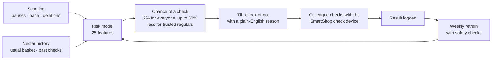

# SmartShop Loss Engine

[](https://github.com/TilakHeble/smartshop-loss-engine/actions/workflows/ci.yml) [](https://smartshop-loss-engine.streamlit.app/)

**When a SmartShop shopper scans the barcode at the till to pay, this system decides whether the till asks for their basket to be checked, so the same staff time catches more loss and far fewer honest shoppers are stopped.**


## The problem

With SmartShop (scan-as-you-shop), customers scan their own items. Some items leave unscanned, a few on purpose and many by honest mistake. Today the till picks about 12% of shoppers **at random** for a check, so most checks stop honest people and find little.

This project makes that decision from the shop's **scan log** and the shopper's **Nectar history** instead, while every shopper keeps a small random chance of a check. That way the checks can still be measured, can't be gamed, and always come with a neutral reason.

## The result

| | Today (random checks) | **This system** |
|---|---|---|
| Loss remaining | \$41,130 | **\$32,216 (−22%)** |
| Value recovered by checks | \$1,705 | **\$9,320 (5.5x)** |
| Recovered per colleague hour | \$13 | **\$70** |
| Honest shoppers stopped | 5,428 | **2,270 (−58%)** |

*Same colleague time as today, on a held-out test period. Shoppers learn the policy and respond to it. Mean of 10 runs.*

> **Simulated, and said so everywhere.** SmartShop data isn't public, so shopper behaviour is simulated on 2.35 million real grocery basket lines (dunnhumby) and calibrated to published loss research. The figures show the method recovers a known truth; a store trial (designed in the [business case](docs/business_case.md#how-to-prove-it-in-real-stores)) is how it would be proven for Sainsbury's.

## Where to look

| You have | Read |
|---|---|
| **1 minute** | This page, and the [live dashboard](https://smartshop-loss-engine.streamlit.app/) (no install) |
| **5 minutes** | The [business case](docs/business_case.md): problem, results, risks, how to trial it |
| **20 minutes** | The [model card](docs/model_card.md) (performance, fairness, data protection, limits) and the [build log](docs/build_log.md) (every step, including what went wrong) |
| **The analysis** | The [notebooks](notebooks/), which GitHub shows directly in the browser |

## How it works



1. **Score.** A model reads the shop's scan log and the member's Nectar history, and estimates the chance a check would find something. It never uses demographics, app or handset, or time of day. The score is compared only with baskets of a similar size, so a big family shop isn't flagged just for being big.
2. **Decide.** The score sets the chance of a check: at least 2% for everyone, at most 50%, and lower for regulars whose recent checks were clean. A random draw decides, so nobody can learn a safe pattern.
3. **Check.** A colleague checks with the SmartShop check device and sees a neutral reason and the items to look at first. A **partial check** covers 25% of the basket, and the device suggests a **full check** if it finds anything. When the till targets a shopper, it asks for a full check.
4. **Learn and measure.** Every decision is logged with its chance, so total loss can be estimated without bias. The model retrains weekly, but only on random checks, and is published only if drift and fairness checks pass.

## What else it covers

- **It survives being wrong.** In 14 stress tests that each change one assumption, loss is 5–24% lower than today in every one. That includes a theft method the model was never built for (barcode switching).
- **Fairness, checked properly.** Every group of honest shoppers is stopped at about half today's rate or less. A gap by age was found and narrowed, which also caught more loss.
- **Shops that never reach the till.** A shoplifter who scans everything, cancels and walks out behind a paying customer costs the whole basket, about an eighth of all loss. Colleagues carry no device, so a cancel with items is finished at the SmartShop checkout instead. Genuine shoppers are helped, walk-outs become countable for the first time, and repeated unfinished cancels bring a full check next time.
- **Dead handsets.** Replacing batteries that keep dying cuts dead handsets by about 93%, and a shop on a dead device resumes instead of being rescanned.
- **Honest about what didn't work.** Item-level "check these items" lists, targeted partial checks and in-app "did you forget?" prompts were all tested and dropped. The reasons are in the [build log](docs/build_log.md).

## Find your way around

| Folder | What's in it |
|---|---|
| [`src/smartshop/`](src/smartshop/) | All the code: simulator, models, the check policy, the decision API, reports |
| [`notebooks/`](notebooks/) | The analysis, step by step (01 to 11) |
| [`docs/`](docs/) | Business case, model card, build log, interview notes, deploy guide, and every chart |
| [`dashboards/`](dashboards/) | The Streamlit dashboard (runs without the data) |
| [`results/`](results/) | Result tables behind every figure in the docs |
| [`dbt/`](dbt/) | The data warehouse models and their 47 data tests |
| [`tests/`](tests/) | Unit, leakage and data-quality tests (run on every push) |
| [`docker/`](docker/) | Container for the decision API |

## Run it

```bash
pip install -e ".[dev,serve,dashboard]"   # Python 3.10+
streamlit run dashboards/app.py            # the dashboard: needs no data
python -m smartshop.run_all                # rebuild everything from the dunnhumby CSVs in data/raw (~15 min)
```

The raw data is the free [dunnhumby Complete Journey](https://www.dunnhumby.com/source-files/) dataset (7 CSVs; it is never committed). To run the decision API, see [docs/deploy.md](docs/deploy.md).

<details>
<summary>Every step on its own</summary>

```bash
make ingest     # CSVs -> Parquet + DuckDB warehouse
make dbt        # build and test the warehouse models
make simulate   # SmartShop sessions, scan events and today's checks
make basket     # basket model
make risk       # session risk model
make policy     # the check policy (game against shoppers who respond)
make stress     # stress tests (~9 min)
make report     # fairness check, trial sizing, dashboard snapshot
make weekly     # decision bundle with drift and release checks
make serve      # decision API on localhost:8000 (docs at /docs)
make test       # all tests
make sample     # no data? a synthetic warehouse with the same schema
```

On Windows (no `make`): `python -m smartshop.run_all --from <step>`.
</details>

<details>
<summary>Glossary</summary>

| Term | Meaning |
|---|---|
| **Check** (or rescan) | A colleague checks a SmartShop basket with the SmartShop check device. **Partial:** 25% of the items, and a full check if anything is missing. **Full:** everything |
| **Random floor** | Every shopper keeps at least a 2% chance of a full check, so nobody is ever safe and the random checks give fair data to learn from |
| **Risk score** | The model's estimate that a check of this shop would find something missing |
| **Size-adjusted score** | The risk score compared only with shops of a similar size |
| **Game-theory (Stackelberg) policy** | The store sets its check chances first; shoppers who steal see them and adapt, and the policy is judged against those adapted shoppers |
| **Trust** | Regulars whose recent full checks were clean get up to 75% fewer checks, never below the floor |
| **Cancel-and-walk** | Scanning items, cancelling SmartShop, paying nothing and walking out behind a customer who has paid |
| **Unfinished cancel** | A cancel with items that was never finished at the SmartShop checkout or paid at a till |
| **Inverse-probability weighting** | Counting each check as standing in for the shops it represents, which keeps loss estimates honest when checks are targeted |
| **Four-fifths rule** | Fairness check: the least-stopped group's rate divided by the most-stopped group's should be at least 0.8 |
| **Stress test** | Rerunning everything with one assumption changed, to see whether the conclusion survives |
</details>

## Built with

Python · SQL · DuckDB · dbt · scikit-learn · LightGBM · FastAPI · Docker · Streamlit · pytest · GitHub Actions

Companion project: the [Nectar Offer Engine](https://github.com/TilakHeble/nectar-offer-engine), which chooses personalised Nectar prices for the same shoppers.
