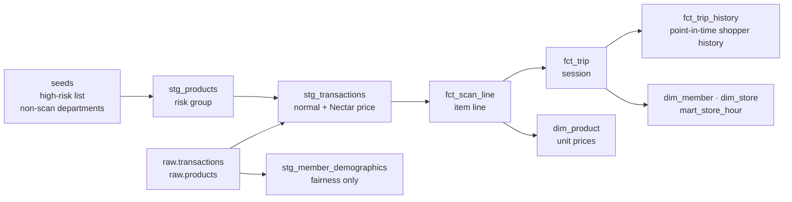

# SmartShop Loss Engine

[](https://github.com/TilakHeble/smartshop-loss-engine/actions/workflows/ci.yml)

**Which SmartShop sessions should be rescanned, and which items checked, so that each minute of colleague time recovers the most loss while honest shoppers are stopped as rarely as possible?**

SmartShop (scan-as-you-shop) loses money when items leave unscanned: some on purpose, usually high-value lines, and some by genuine mistake. Today partial and full rescans are mostly random. This project replaces them with **risk-based rescans that keep a small random floor**, so the policy can still be measured, can't be gamed, and gives colleagues a neutral explanation.

It is the companion to the [Nectar Offer Engine](https://github.com/TilakHeble/nectar-offer-engine): the same members, the same data and shared code. Nectar decides each member's personalised prices; SmartShop is where the member sees them, Nectar price next to normal price, while scanning.

> Status: **weeks 1–3 of 10 complete** (ingestion, EDA, dbt warehouse, calibrated simulator). 47 dbt data tests and 28 Python tests, including a point-in-time leakage test, run in CI on every push.

## What makes it different

| Idea | What it does |
|---|---|
| ⭐ **Game-theory rescan policy** | Risk sets each session's rescan *probability*, chosen (as a Stackelberg security game, the method used to schedule airport checkpoints) so that a shopper who adapts to the policy has no safe way to skip items |
| ⭐ **Targeted rescans: "check these 3 items"** | A basket model ranks which items are most likely missing, so a partial rescan recovers close to a full one in a fraction of the time |
| ⭐ **Nectar-linked trust** | A credit-score-style trust score, built from clean rescans and kept per member across stores, lowers rescans for the honest majority. It decays and never drops below the random floor |
| **True loss from biased rescans** | Known rescan probabilities give an unbiased (inverse-probability-weighted) estimate of total loss, including sessions never checked |

**Target headline:** with the same colleague time, recover more loss than random rescans *and* stop fewer honest shoppers, while holding up against shoppers who adapt.

## Week 1 findings

[dunnhumby — *The Complete Journey*](https://www.dunnhumby.com/source-files/), weeks 17–102: 2.35m scanned item lines, 230k trips, 2,492 members, 532 stores. Amounts in US dollars, as recorded.


| # | Finding | Decision |
|---|---|---|
| 1 | Median trip has 5 item lines (7 units); 15% of trips have 20+ lines | Cost a rescan in minutes per item, not per trip |
| 2 | The 3 most valuable items hold 46% of basket value in 10–19-line trips vs 23% for 3 random items, and 27% vs 10% at 20+ lines | Targeted partial rescans are worth building, before any model |
| 3 | High-risk categories (fresh meat, alcohol, tobacco, health & beauty, baby, coffee) are 9% of lines but 20% of value; 72% of trips with 10+ lines contain one | They anchor the simulator's deliberate-skip behaviour and the risk features |
| 4 | Half of lines carry a Nectar price; valuing loss at the normal price overstates it by 18% overall, 32% for fresh meat, and almost 0% for alcohol and tobacco | Value every lost item at the shopper's own price, line by line |
| 5 | 20% of lines are multi-buys, holding 39% of units | Simulate quantity under-declaring; check quantities in targeted rescans |
| 6 | 4pm–7pm carries 30% of daytime trips; the busiest hour is 1.7x the average | Rescan capacity moves during the day (v2: queue-aware capacity) |
| 7 | 89% of trips come with 10+ earlier trips by the same member; 91% of members use 2+ stores and 56% make over 20% of trips away from their main store | Trust needs member-level history via Nectar, not per-store history |


Full analysis: [`notebooks/01_eda.ipynb`](notebooks/01_eda.ipynb) (HTML export in `reports/`).

## Week 2: the warehouse

A dbt project on DuckDB turns raw transactions into the tables every later week reads from.



| Model | Grain | What it is for |
|---|---|---|
| `fct_scan_line` | Item line | What was scanned, at normal and Nectar price, with risk group and value rank in the basket. Week 3 expands it into timed scans |
| `fct_trip` | Session | Basket size, value, high-risk share, multi-buys, top-3 value share, peak-hour flag, member's trip number |
| `fct_trip_history` | Session | What the system knows about the shopper **when the session starts**: earlier trips, stores, days since last trip, usual basket. Built only from earlier trips |
| `dim_product` | Product | Normal and Nectar unit prices, used to value an unscanned item at the shopper's price |
| `dim_member`, `dim_store` | Member / store | Reporting: main store, stores used, demand profile |
| `mart_store_hour` | Store × hour | Sessions and items arriving per open day: the input to rescan capacity (week 6) |
| `stg_member_demographics` | Member | **Fairness checks only.** Kept apart, and a test fails if any feature table carries a demographic column |

**Tests that protect the later weeks**
- **No leakage.** A pytest rebuilds the warehouse with the data cut off at day 400 and checks every earlier session gets *exactly* the same history. Checked by planting a leak (one history column using the member's whole period): the test fails and names the column.
- **Money reconciles.** Line totals equal session totals equal staging, to the cent; the Nectar price is never above the normal price.
- **Business rules are data.** The high-risk list and non-scan departments are dbt seeds, with a test that every seed entry exists in the product table, so a typo can't silently drop a category.
- **CI runs the real pipeline.** Raw data is never committed, so CI generates a small synthetic warehouse with the same schema (every high-risk product, fuel lines, returns, multi-store members) and runs the full dbt build, all 47 data tests and the leakage test on it.
- The rebuilt marts reproduce the week 1 analysis exactly, figure for figure.

## Week 3: a simulator calibrated to published research

SmartShop data isn't public, and the truth about loss (who skipped what, and why) is never fully known even inside a retailer. `smartshop.simulate` adds SmartShop behaviour on top of the **real** baskets and checks it against published figures.

| Real (Complete Journey) | Simulated (`simulate/config.py`) |
|---|---|
| Members, stores, days, checkout times | Who adopted SmartShop and when; app or handset |
| Every basket's items, quantities, normal and Nectar prices | Hidden shopper type: honest, careless, opportunist, deliberate, adaptive |
| Repeat visits per member | Genuine mistakes (missed and double scans) and deliberate non-scans |
| | Timed scan-event log with deletions |
| | Today's random partial and full rescans, and what they found |

Every SmartShop session is Nectar-linked: [Sainsbury's requires a Nectar card](https://help.sainsburys.co.uk/help/products/smartshop-faq) for both the app and the handset. The cold-start case is a **new SmartShop user**.

**Calibrated to the ECR Retail Loss Group's studies** ([Beck 2018](https://ecrloss.com/research-paper/self-checkout-loss-measurement/): 13 retailers, 140m scan-and-go transactions, 17m audits; [Beck 2022](https://www.rgis.co.uk/wp-content/uploads/2023/04/ECR_Global_Study_on_Self-checkout_in_Retail.pdf): 93 retailers):

| Check | Simulated | Published |
|---|---|---|
| Sessions with an error: 20 / 50 / 100 units | 31% / 65% / 91% | 30% / 60% / 90% |
| Non-scans as share of item errors (rest are double scans) | 76% | 77% |
| Deliberate share of non-scanned value | 56% | 46–56% |
| Net loss, share of SmartShop sales | 2.0% | 0.96–4.68% |
| Sessions rescanned today | 12% | ~12% |
| Partial rescans that find an error | 3.2% | 2.88% |


**Design choices that matter later**
- **Truth and observations are separated.** Models only ever read `sim_obs` (sessions, scan events, rescan results). The hidden truth sits in `sim_truth`, and a test fails if any `gt_` column reaches `sim_obs`.
- **Signals come from mechanisms, not labels.** Shopping time follows the *true* basket, so a session with unscanned items looks slow for what was scanned; some deliberate skips are scan-then-delete. Each signal alone is weak (AUC 0.58–0.67), as in a real store.
- **Shoppers respond to the policy.** Opportunists are deterred as the rescan probability rises; adaptive shoppers steal only when the expected haul beats the expected cost of being caught. This is what the game-theory policy (week 6) has to beat.
- **Common random numbers.** Every random draw is made once per unit and session, so any two policies are compared on identical shoppers and baskets.
- Every session's scan log accounts exactly for its true basket: scanned = true − missed + double-scanned (tested).

| Finding | Implication |
|---|---|
| 14% of members cause 76% of the loss; genuine mistakes by everyone else are the other 24% | Two problems: catch deliberate skips, and fix honest mistakes without treating people as suspects |
| High-risk items are 19% of value but 47% of deliberately skipped value | Targeted rescans should look there first |
| Random partial rescans put loss at 0.20% of sales, a tenth of the truth (2.04%); random full rescans estimate 1.99% (95% CI 1.46–2.53%) | Measure loss with a random floor of *full* rescans, never from partial checks (as [ECR] found in practice) |
| Today's random rescans: 223 colleague hours recover \$10.69 an hour and 3.1% of loss; 96% of rescans stop someone who skipped nothing on purpose | **The baseline the policy must beat** |


Full validation: [`notebooks/02_simulator.ipynb`](notebooks/02_simulator.ipynb). Results are claims that *the method recovers the known truth*, not that it would cut Sainsbury's loss by a given amount; week 8 reruns the comparison under lower and higher loss settings.

## Ground rules

- **No demographics or protected characteristics** in any model; they are used only for the fairness check. Proxies such as store location are checked too.
- **Stopping an honest shopper is a cost** in the objective, not only £ recovered.
- **No history is not a reason to rescan more:** new SmartShop users get the standard rate.
- **A colleague makes the final call.** Every decision comes with a plain-English reason and the items to check.
- **Rescans never touch Nectar prices or points.** The Nectar link is only used positively.

## Roadmap

**v1: the core system**

| Week | Deliverable |
|---|---|
| 1 ✅ | Repo, ingestion (shared with Nectar), SmartShop EDA |
| 2 ✅ | dbt warehouse: session, scan-line (normal and Nectar price) and point-in-time shopper-history models, with tests |
| 3 ✅ | Session simulator: honest, careless, opportunist, deliberate and adaptive shoppers, calibrated to published ECR figures |
| 4 | Basket model: which items are probably in the basket but unscanned |
| 5 | Session risk model against three baselines: random, simple rules, top-k |
| 6 | Game-theory rescan policy |
| 7 | Targeted rescans and Nectar trust score |
| 8 | True loss from biased rescans (IPW) and the headline comparison |
| 9 | FastAPI rescan-decision API in Docker; gated weekly pipeline |
| 10 | Streamlit dashboard, fairness check, model card with a data-protection section, business case |

**v2: after v1**: deliberate vs accidental misses, deterrence value of a rescan, queue-aware capacity, a conformal cap on honest shoppers stopped, data-driven product hotspots, a nudge experiment sized with CUPED, in-app "you might have forgotten…" prompts, scan-time camera verification.

## Quick start

Needs the 7 Complete Journey CSVs used here (the in-store promotions file is not needed).

```bash
pip install -e ".[dev]"     # also installs the Nectar engine, pinned to an exact commit
# put the CSVs in data/raw/
make ingest                 # CSV -> typed Parquet + DuckDB warehouse (~3 s)
make dbt                    # build and test the staging and mart models (~15 s)
make simulate               # SmartShop sessions, scan events and today's rescans (~10 s)
make eda                    # run the EDA notebook and export HTML
make test                   # unit, leakage and data-quality tests
make dbt-docs               # browse model documentation and lineage
make sample                 # no data? build a synthetic warehouse with the same schema
```

On Windows without `make`: `python -m smartshop.ingest.load_raw`, then `cd dbt; dbt build --profiles-dir .; cd ..`, then `python -m smartshop.simulate.simulator`, then `pytest -q`. Use Python 3.12, as for Nectar.

## Repository layout

```
├── src/smartshop/
│   ├── config.py            # paths; reads business rules from dbt seeds
│   ├── ingest/load_raw.py   # reuses Nectar's typed table specs -> Parquet + DuckDB
│   ├── ingest/sample.py     # synthetic warehouse with the real schema (CI, demos)
│   ├── simulate/            # SimConfig (sources), simulator, rescan model, calibration
│   ├── warehouse.py         # connect to DuckDB, run dbt from Python
│   └── viz.py               # chart style shared with Nectar
├── dbt/                     # seeds, staging, marts, 47 data tests
├── notebooks/               # 01 EDA · 02 simulator validation
├── reports/                 # HTML export + figures
├── tests/                   # marts on synthetic data, point-in-time leakage, data-quality contract
└── .github/workflows/ci.yml # ruff + dbt parse + pytest (full dbt build on synthetic data)
```

## Tech stack

Python · SQL · DuckDB · Parquet · dbt · pytest · GitHub Actions. To come: LightGBM · PuLP · MLflow · FastAPI · Docker · Prefect · Streamlit.
