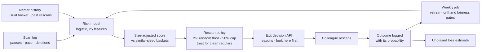
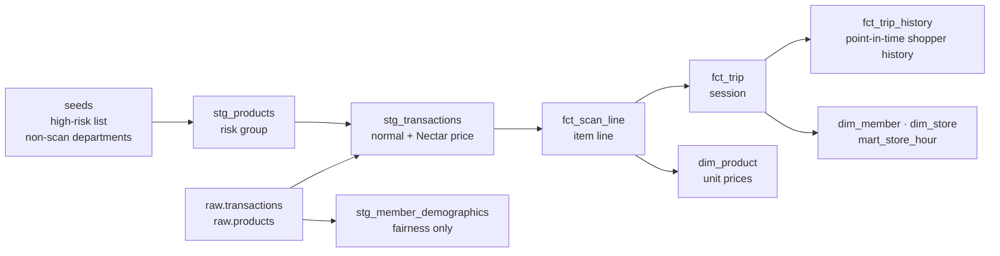
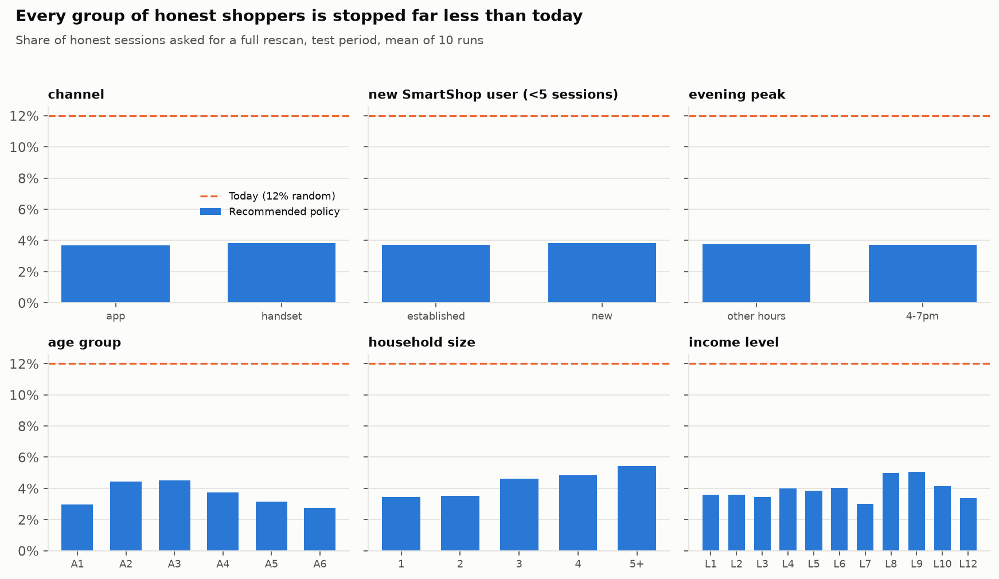
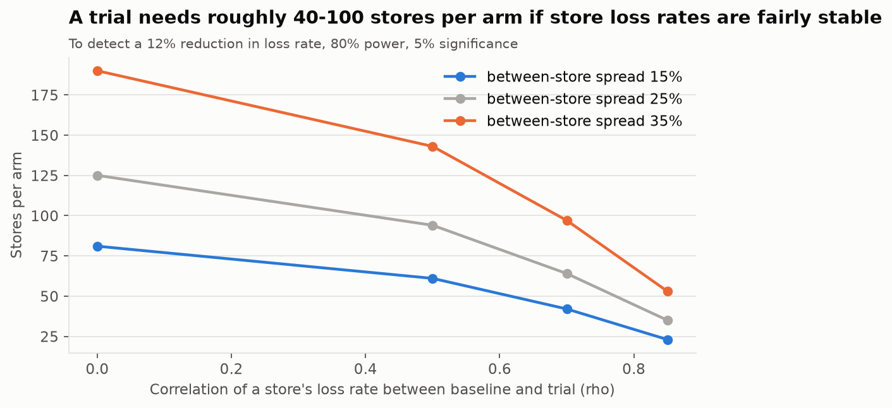
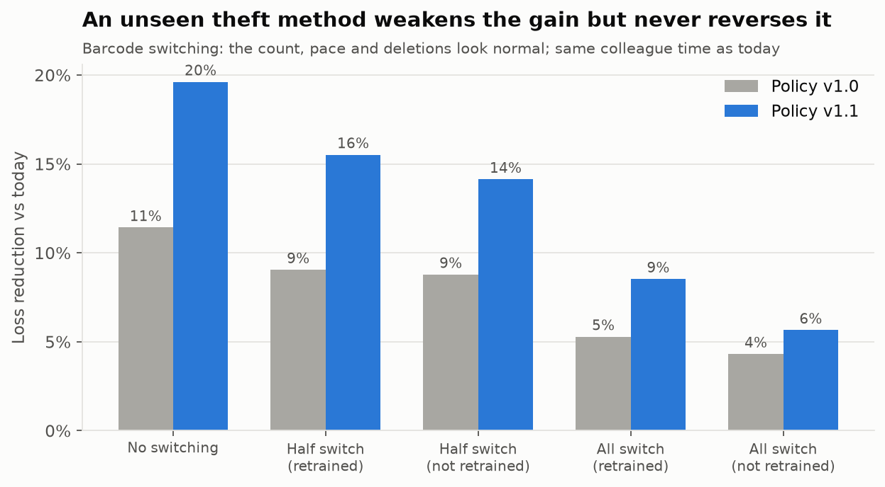
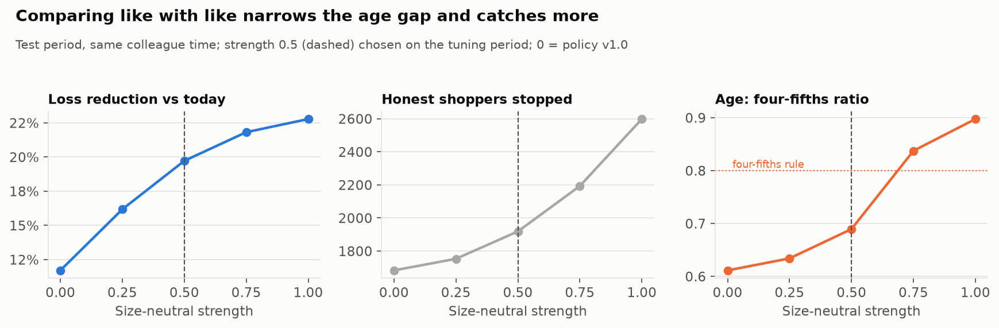

# SmartShop Loss Engine

[](https://github.com/TilakHeble/smartshop-loss-engine/actions/workflows/ci.yml) [](https://smartshop-loss-engine.streamlit.app/)

**Which SmartShop sessions should a colleague rescan, so that each minute of their time recovers the most loss while honest shoppers are stopped as rarely as possible?**

SmartShop (scan-as-you-shop) loses money when items leave unscanned: some on purpose, many by genuine mistake. Today about 12% of sessions are rescanned at random. This project replaces random rescans with **risk-based rescans that keep a small random floor**, so the policy can still be measured, can't be gamed, and gives colleagues a neutral reason.

**[Live dashboard](https://smartshop-loss-engine.streamlit.app/)** · **[Business case](docs/business_case.md)** (2 pages) · **[Model card](docs/model_card.md)** · **[Interview notes](docs/interview_notes.md)** · companion to the [Nectar Offer Engine](https://github.com/TilakHeble/nectar-offer-engine)


## The result

Same colleague time as today; test period; shoppers who learn the policy and respond; trust updated over four cycles; mean of 10 runs. SmartShop behaviour is simulated on 2.35m real basket lines and calibrated to published loss research, so these figures show that the method recovers a known truth, not a forecast for Sainsbury's.

| | Today (random rescans) | **Recommended policy (v1.1)** |
|---|---|---|
| Loss remaining | \$41,639 | **\$33,430 (−20%)** |
| Value recovered by rescans | \$1,196 | **\$8,513 (7.1x)** |
| Recovered per colleague hour | \$11 | **\$75** |
| Honest shoppers stopped | 5,428 | **1,918 (−65%)** |

- **It survives being wrong.** Fourteen stress tests each change one assumption and rerun everything. Loss is 6–22% lower in every one, including a theft method the model was never designed for: barcode switching, where the scan count, pace and deletions all look normal ([v1.1](#v11-an-unseen-theft-method-and-closing-the-age-gap)).
- **It is checked for fairness properly.** Every group of honest shoppers is stopped at under half today's rate. A check that separates real gaps from small-group chance found an age gap; scoring each session against baskets of a similar size narrows it *and* catches more.
- **Loss stays measurable.** Averaging what targeted rescans find overstates loss about 4x; weighting each rescan by its logged probability is unbiased to within about 1%.
- **What didn't work is reported, not hidden:** targeted partial checks (full rescans recover more per colleague-minute) and in-app "did you forget?" prompts (usually wrong).

## How it works



1. **Score.** At the exit, a logistic model reads the session's scan log and the member's Nectar history (no demographics, channel or time of day) and estimates the chance a rescan finds something. The score is then compared with sessions of a similar basket size, because big baskets nearly always hold an honest slip and are the slowest to rescan.
2. **Decide.** The score sets a rescan *probability* between a 2% random floor (anyone can be checked) and a 50% cap (nobody is checked every trip), lowered for regulars whose recent rescans were clean. A random draw decides, so no shopper can learn a safe pattern. The colleague sees plain-English reasons and the shopper's usual high-risk items that are missing.
3. **Learn and measure.** Every decision is logged with its probability. Each week the model retrains on random full rescans and is published only if budget, drift and fairness gates pass; total loss is estimated without bias from the logged probabilities.

## What makes it different

| Idea | What it does |
|---|---|
| ⭐ **Game-theory rescan policy** | The store commits to rescan *probabilities*; shoppers learn them and choose whether, and how much, to steal (a Stackelberg game). Every policy is judged against their best responses, within today's colleague time, with a random floor and a per-member cap |
| **Targeted checks: "check these items"** | A basket model, trained without any theft label, ranks which product types are probably in the bags but unscanned. Tested honestly: it finds honest mistakes with ~25% fewer units counted, but full rescans recover more per colleague-minute, so it serves as a risk feature and a "look here first" hint, not a separate check |
| **Nectar-linked trust** | Clean full rescans earn a member fewer rescans (up to 75% off, per member across stores); a small honest slip does not reset it; the random floor always applies. A modest fairness refinement that thieves cannot easily earn |
| **True loss from biased rescans** | Known rescan probabilities give an unbiased (inverse-probability-weighted) estimate of total loss, including sessions never checked |
| **Production shape** | A 25 ms decision API with reasons and "look here first" items, a weekly job that publishes only through budget, drift and fairness gates, and a fairness check that separates real gaps from small-group chance |

## Run it

```bash
pip install -e ".[dev,serve,dashboard]"   # Python 3.12
streamlit run dashboards/app.py            # the dashboard: needs no data
python -m smartshop.run_all                # rebuild everything from the 7 CSVs in data/raw (~15 min)
```

More options in [Quick start](#quick-start); the decision API runs in Docker ([docs/deploy.md](docs/deploy.md)).

---

# How it was built

The build log, week by week. Each week reports what it found at the time, including the mistakes it caught; the [v1.1 section](#v11-an-unseen-theft-method-and-closing-the-age-gap) at the end improves on weeks 8 and 10.

| Week | | Week | |
|---|---|---|---|
| 1 | [Data and SmartShop EDA](#week-1-findings) | 6 | [The rescan game](#week-6-the-rescan-game) |
| 2 | [dbt warehouse](#week-2-the-warehouse) | 7 | [Trust and targeted checks](#week-7-trust-for-honest-regulars-and-targeted-checks) |
| 3 | [Calibrated simulator](#week-3-a-simulator-calibrated-to-published-research) | 8 | [Headline, measurement, stress tests](#week-8-the-headline-measurement-and-stress-tests) |
| 4 | [Basket model](#week-4-the-basket-model) | 9 | [Decision API and weekly job](#week-9-the-rescan-decision-api-and-the-weekly-job) |
| 5 | [Session risk model](#week-5-the-session-risk-model) | 10 | [Fairness, dashboard, model card, business case](#week-10-fairness-dashboard-model-card-and-business-case) |

## Week 1 findings

[dunnhumby — *The Complete Journey*](https://www.dunnhumby.com/source-files/), weeks 17–102: 2.35m scanned item lines, 230k trips, 2,492 members, 532 stores. Amounts in US dollars, as recorded.


| # | Finding | Decision |
|---|---|---|
| 1 | Median trip has 5 item lines (7 units); 15% of trips have 20+ lines | Cost a rescan in minutes per item, not per trip |
| 2 | The 3 most valuable items hold 46% of basket value in 10–19-line trips vs 23% for 3 random items, and 27% vs 10% at 20+ lines | Targeted partial rescans are worth building, before any model |
| 3 | High-risk categories (fresh meat, alcohol, tobacco, health & beauty, baby, coffee) are 9% of lines but 20% of value; 72% of trips with 10+ lines contain one | They anchor the simulator's deliberate-skip behaviour and the risk features |
| 4 | Half of lines carry a Nectar price; valuing loss at the normal price overstates it by 18% overall, 32% for fresh meat, and almost 0% for alcohol and tobacco | Value every lost item at the shopper's own price, line by line |
| 5 | 20% of lines are multi-buys, holding 39% of units | Simulate quantity under-declaring; check quantities in targeted rescans |
| 6 | 4pm–7pm carries 30% of daytime trips; the busiest hour is 1.7x the average | Rescan capacity moves during the day (v2: queue-aware capacity) |
| 7 | 89% of trips come with 10+ earlier trips by the same member; 91% of members use 2+ stores and 56% make over 20% of trips away from their main store | Trust needs member-level history via Nectar, not per-store history |


Full analysis: [`notebooks/01_eda.ipynb`](notebooks/01_eda.ipynb) (HTML export in `reports/`).

## Week 2: the warehouse

A dbt project on DuckDB turns raw transactions into the tables every later week reads from.



| Model | Grain | What it is for |
|---|---|---|
| `fct_scan_line` | Item line | What was scanned, at normal and Nectar price, with risk group and value rank in the basket. Week 3 expands it into timed scans |
| `fct_trip` | Session | Basket size, value, high-risk share, multi-buys, top-3 value share, peak-hour flag, member's trip number |
| `fct_trip_history` | Session | What the system knows about the shopper **when the session starts**: earlier trips, stores, days since last trip, usual basket. Built only from earlier trips |
| `dim_product` | Product | Normal and Nectar unit prices, used to value an unscanned item at the shopper's price |
| `dim_member`, `dim_store` | Member / store | Reporting: main store, stores used, demand profile |
| `mart_store_hour` | Store × hour | Sessions and items arriving per open day: the input to rescan capacity (week 6) |
| `stg_member_demographics` | Member | **Fairness checks only.** Kept apart, and a test fails if any feature table carries a demographic column |

**Tests that protect the later weeks**
- **No leakage.** A pytest rebuilds the warehouse with the data cut off at day 400 and checks every earlier session gets *exactly* the same history. Checked by planting a leak (one history column using the member's whole period): the test fails and names the column.
- **Money reconciles.** Line totals equal session totals equal staging, to the cent; the Nectar price is never above the normal price.
- **Business rules are data.** The high-risk list and non-scan departments are dbt seeds, with a test that every seed entry exists in the product table, so a typo can't silently drop a category.
- **CI runs the real pipeline.** Raw data is never committed, so CI generates a small synthetic warehouse with the same schema (every high-risk product, fuel lines, returns, multi-store members) and runs the full dbt build, all 47 data tests and the leakage test on it.
- The rebuilt marts reproduce the week 1 analysis exactly, figure for figure.

## Week 3: a simulator calibrated to published research

SmartShop data isn't public, and the truth about loss (who skipped what, and why) is never fully known even inside a retailer. `smartshop.simulate` adds SmartShop behaviour on top of the **real** baskets and checks it against published figures.

| Real (Complete Journey) | Simulated (`simulate/config.py`) |
|---|---|
| Members, stores, days, checkout times | Who adopted SmartShop and when; app or handset |
| Every basket's items, quantities, normal and Nectar prices | Hidden shopper type: honest, careless, opportunist, deliberate, adaptive |
| Repeat visits per member | Genuine mistakes (missed and double scans) and deliberate non-scans |
| | Timed scan-event log with deletions |
| | Today's random partial and full rescans, and what they found |

Every SmartShop session is Nectar-linked: [Sainsbury's requires a Nectar card](https://help.sainsburys.co.uk/help/products/smartshop-faq) for both the app and the handset. The cold-start case is a **new SmartShop user**.

**Calibrated to the ECR Retail Loss Group's studies** ([Beck 2018](https://ecrloss.com/research-paper/self-checkout-loss-measurement/): 13 retailers, 140m scan-and-go transactions, 17m audits; [Beck 2022](https://www.rgis.co.uk/wp-content/uploads/2023/04/ECR_Global_Study_on_Self-checkout_in_Retail.pdf): 93 retailers):

| Check | Simulated | Published |
|---|---|---|
| Sessions with an error: 20 / 50 / 100 units | 31% / 65% / 88% | 30% / 60% / 90% |
| Non-scans as share of item errors (rest are double scans) | 76% | 77% |
| Deliberate share of non-scanned value | 55% | 46–56% |
| Net loss, share of SmartShop sales | 2.0% | 0.96–4.68% |
| Sessions rescanned today | 12% | ~12% |
| Partial rescans that find an error | 3.0% | 2.88% |


**Design choices that matter later**
- **Truth and observations are separated.** Models only ever read `sim_obs` (sessions, scan events, rescan results). The hidden truth sits in `sim_truth`, and a test fails if any `gt_` column reaches `sim_obs`.
- **Signals come from mechanisms, not labels.** Shopping time follows the *true* basket, so a session with unscanned items looks slow for what was scanned; some deliberate skips are scan-then-delete. Each signal alone is weak (AUC 0.56–0.66), as in a real store.
- **Shoppers respond to the policy.** Opportunists are deterred as the rescan probability rises; adaptive shoppers steal only when the expected haul beats the expected cost of being caught. This is what the game-theory policy (week 6) has to beat.
- **Common random numbers.** Every random draw is made once per unit and session, so any two policies are compared on identical shoppers and baskets.
- Every session's scan log accounts exactly for its true basket: scanned = true − missed + double-scanned (tested).

| Finding | Implication |
|---|---|
| 14% of members cause 75% of the loss; genuine mistakes by everyone else are the other 25% | Two problems: catch deliberate skips, and fix honest mistakes without treating people as suspects |
| High-risk items are 19% of value but 47% of deliberately skipped value | Targeted rescans should look there first |
| Random partial rescans put loss at 0.23% of sales, about a ninth of the truth (2.04%); random full rescans estimate 1.97% (95% CI 1.51–2.45%) | Measure loss with a random floor of *full* rescans, never from partial checks (as [ECR] found in practice) |
| Today's random rescans: 221 colleague hours recover \$10.94 an hour and 3.1% of loss; 96% of rescans stop someone who skipped nothing on purpose | **The baseline the policy must beat** |


Full validation: [`notebooks/02_simulator.ipynb`](notebooks/02_simulator.ipynb). Results are claims that *the method recovers the known truth*, not that it would cut Sainsbury's loss by a given amount; week 8 reruns the comparison under lower and higher loss settings.

## Week 4: the basket model

**What is probably in the trolley but not on the scan list?** Half of missing value is a product type never scanned, half is a short count of a type that was (2 of 3 yogurts), so the model scores *every* product type in a session.

- **Masked-basket training.** Staffed-till baskets are complete: hide 10% of their units at random and train LightGBM to say where they were, from the visible rest and the member's Nectar history (earlier trips only; for SmartShop trips, only what was scanned). No theft label is ever used. Held-out AUC 0.93, calibrated (mean prediction 0.26% vs 0.25% actual).
- **A fair test.** Every method gets the same budget of units a colleague may count per session, and the simulator's detection rules: mistakes are found when their type is counted; items skipped on purpose are usually concealed outside the bags, so *any* partial check rarely finds them.


| Finding | Implication |
|---|---|
| The model's check list finds as many honest mistakes as today's random units while counting about 25% fewer units (1.3–1.5x found per unit) | Faster, friendlier partial rescans for honest shoppers |
| "Check the most valuable scanned items" finds about a third as much per unit as random | Intuition is not enough; every rule is measured against random |
| No partial check, random or targeted, finds much deliberate loss; "this basket looks incomplete" is a weak risk signal on its own (AUC 0.55) | **Theft is caught by choosing *who* gets a full rescan** (weeks 5–6), not by item lists |

The gain is deliberately reported as modest: genuine mistakes fall roughly at random across units, so random picks already sample where they are. If real mistakes cluster on particular products (bulky items, loose produce, multi-buys), targeted lists gain more, and the random floor of full rescans is what would reveal it. Full analysis: [`notebooks/03_basket_model.ipynb`](notebooks/03_basket_model.ipynb).

## Week 5: the session risk model

Week 4 showed partial checks rarely find items skipped on purpose (they are concealed), so catching theft is about **who gets a full rescan**. The risk model ranks sessions for it.

- **Only what a store can observe.** Features: the session's scan log (pauses, pace, deletions, what was scanned) and the member's history from earlier trips (Nectar purchases, earlier sessions, earlier rescan outcomes, the basket model's "looks incomplete" gap). Labels: what *random full* rescans found: unbiased, but only 926 in the training period.
- **Honest selection.** Label, features and model chosen by repeated cross-validation of *observable* value capture on those rescans; the hidden truth is used once, at the end. Chosen: logistic regression on 27 features, so every flag comes with plain-English reasons ("long pause between scans; usually deletes a lot").


| Flag the top 12% (today's rescan rate) | Deliberate loss caught | Net loss caught |
|---|---|---|
| Random (today) | 13% | 12% |
| Biggest baskets | 22% | 28% |
| Rule of thumb (red-flag points) | 36% | 37% |
| Best single signal (deletion rate) | 50% | 40% |
| **Risk model** | **53%** | **54%** |
| Ceiling: same features, trained on hidden truth | 82% | 67% |

| Finding | Implication |
|---|---|
| About 4x today's random selection at the same rescan rate | Who gets rescanned is where the gain is |
| A 5–20% random full floor adds only 2–6 points; the ceiling is trained on *why* items were missing | The bottleneck is label quality (a rescan records *that* items were missing, not why), more than label count |
| **The first fairness check failed:** handset users, evening shoppers and new SmartShop users were flagged far more, though none of these changes behaviour. With so few labels the model learned spurious channel and time effects, and tenure features made newcomers look unusual | Channel, time of day and tenure removed from scoring; missing history filled with typical values. Channel and evening shoppers now pass comfortably (0.97–0.98); new users pass narrowly (0.82, interval 0.69–0.97) |
| Honest households with bigger baskets are still stopped more: honest-stop ratios 0.51 (age), 0.53 (household size), 0.39 (income), with wide intervals (some groups have very few households) | A review item, not proof. Carried into the policy (a per-member cap on rescans, week 6) and the full check (week 10) |

Full analysis: [`notebooks/04_risk_model.ipynb`](notebooks/04_risk_model.ipynb).

## Week 6: the rescan game

The policy decides **who gets a full rescan, with what probability**, using exactly today's colleague time. It must work against shoppers who learn it.

- **The game.** The store leads: it commits to a function from risk score to rescan probability. Shoppers follow: opportunists steal less when a rescan is likelier; adaptive shoppers choose to take 0, 25, 50 or 100% of their usual haul, since taking less keeps their scan log calmer and their score lower. Every version of reality is simulated once from the same random draws, so any policy is evaluated exactly against shoppers' best responses.
- **Fair comparison.** Policy shapes are fitted on the tuning period (days 331–500); the test period only evaluates, with volume set to today's 113 colleague hours. Every policy keeps the **2% random floor** of full rescans: unbiased measurement and training labels.


| Same colleague time (test period) | Loss remaining | Recovered | Per colleague hour | Honest shoppers stopped |
|---|---|---|---|---|
| Today: random partial + full | \$41,639 | \$1,196 | \$11 | 5,428 |
| Random full rescans | \$40,851 | \$3,023 | \$27 | 3,182 |
| Threshold + random floor | \$35,605 | \$7,302 | \$64 | 1,579 |
| **Randomised, cap 0.5 (recommended)** | **\$36,767** | **\$6,483** | **\$57** | **1,665** |

| Finding | Implication |
|---|---|
| The recommended policy leaves 12% less loss, recovers 5.4x as much and stops 69% fewer honest shoppers than today | Rescans go where they find things |
| Judged against shoppers who keep today's behaviour, a threshold policy's recovery is overstated by 37% | Policies must be evaluated against shoppers who learn them |
| Adaptive shoppers do exploit a threshold (about a fifth hold back to stay under it), but randomising gains little: deterring them needs about a one-in-three rescan chance, while the budget allows about 7% | Here the store wins by **detection, not deterrence**; the best policy is close to threshold + random floor |
| Without a cap, some honest members would be rescanned on nearly every trip; a cap of 0.5 stops that for about 3% more loss, but moves group gaps only a little | Cap 0.5 recommended; age, household and income gaps stay a monitored review item (week 10) |
| Today's many cheap partial rescans do deter opportunists (18% steal vs 22% under fewer, full rescans) | A deliberate trade: a little less deterrence for about 5x the recovery |


Full analysis: [`notebooks/05_rescan_policy.ipynb`](notebooks/05_rescan_policy.ipynb). The game is one session at a time (member history held at today's); week 8 stress-tests the shoppers' assumed penalty and sensitivity.

## Week 7: trust for honest regulars, and targeted checks

Two ideas tested on the rescan game, with colleague time held at today's level.

**Nectar-linked trust**, played over four rescan cycles: each cycle's rescans (drawn at the policy's probabilities) update trust for the next, and shoppers respond to the probabilities they face.


| Finding | Implication |
|---|---|
| With colleague time fixed, trust leaves total loss and honest stops about unchanged, but 12% fewer honest regulars are stopped 3+ times and recovery edges up | Added to the recommended policy as a fairness refinement, not a loss lever |
| "Any find resets trust" hurts honest families: big baskets often contain a slip. Letting one small slip (one item under \$10) pass fixes that | The rule: each clean full rescan takes 25% off, up to 75%; bigger finds reset it |
| Thieves are 14% of members but get about 10% of the trust discount | Trust built on full rescans is hard to game |
| Counting clean *partial* checks spreads trust to far more members, thieves included, and is worse on loss and honest stops | Never build trust on checks that cannot see concealed items |

**Targeted checks** (week 4's lists) against full rescans, per colleague-minute, at three risk bands under the recommended policy:


| Finding | Implication |
|---|---|
| Full rescans recover several times more per colleague-minute than a 3-unit targeted check at every band (\$1.20 vs \$0.32 on flagged sessions) | Targeted checks do not earn colleague time; the basket model's value is as a risk feature and a "look here first" hint inside a full rescan |
| An in-app "did you forget...?" prompt about the model's top guess would be right only 10–24% of the time and point at at most 5–9% of the value missed by mistake | Not worth interrupting shoppers |

Full analysis: [`notebooks/06_trust_and_targeting.ipynb`](notebooks/06_trust_and_targeting.ipynb). The recommended policy (week 6 randomised policy plus this trust rule) is stored in `models/policy.json`.

## Week 8: the headline, measurement and stress tests

**Headline** (test period, today's colleague time, shoppers respond, trust over four cycles, 10 runs):

| | Today | Recommended | Change |
|---|---|---|---|
| Loss remaining | \$41,639 | \$36,767 (range \$36,639–36,890) | −12% |
| Value recovered | \$1,196 | \$6,640 | 5.6x |
| Recovered per colleague hour | \$11 | \$59 | 5.6x |
| Honest shoppers stopped | 5,428 | 1,683 | −69% |

**Measuring loss once rescans are targeted.** Rescanned sessions are no longer a random sample. Over 30 runs:


| Estimate of total loss | Bias | Typical error per period |
|---|---|---|
| Naive: average found per rescan x sessions | +266% | 16% |
| **Inverse-probability weighted** (each rescan counts for 1/p sessions) | −0.7% | 9% |
| Random floor only (2% audit sample) | −1.3% | 15% |

So every rescan's probability is logged with its outcome (the API returns it with each decision), loss is reported with weighting, and the random floor stays as the cross-check.

**Stress tests.** Ten scenarios, each changing one assumption and rerunning the whole chain (simulate, retrain the risk model, refit the policy, compare at today's colleague time):


| Finding | Implication |
|---|---|
| The policy beats today in every scenario: loss 6–13% lower, recovery 3.9–6.4x, honest stops down 69–70% | The conclusion does not hinge on one assumption |
| It helps least with little theft (6%) or cautious thieves (8%): today's flat 12% rescan rate deters cautious thieves, and targeting gives some of that up | The trade-off a store should know; the random floor is the lever if deterrence matters more |
| Randomising beats a plain threshold by at most 1.4%; a static evaluation overstates recovery by 20–52% in every scenario | Detection, not deterrence, drives the result; always evaluate against shoppers who respond |

Full analysis: [`notebooks/07_headline_and_stress_tests.ipynb`](notebooks/07_headline_and_stress_tests.ipynb). Stress tests: `python -m smartshop.experiments.sensitivity` (about 9 minutes).

## Week 9: the rescan decision API and the weekly job

When a SmartShop shopper goes to pay, the till or app sends the session's scan log to `POST /decide` and gets back a decision a colleague can act on:

A real response from the current bundle, for a simulated session in the last week of the data (the draw fixed at 0.2 for the example):

```json
{
  "decision": "full_rescan",
  "rescan_probability": 0.375,
  "draw": 0.2,
  "audit_sample": false,
  "risk_score": 0.9598,
  "reasons": ["long pause between scans", "many items", "large basket value"],
  "look_here_first": ["BEEF", "LUNCHMEAT", "CHICKEN"],
  "trust_multiplier": 0.75,
  "known_member": true,
  "unknown_products": 0,
  "bundle_version": "20261027T133508Z-700821e"
}
```

This member has earned a trust discount (0.75), so even a very high score is capped at 0.375 rather than 0.5.

- **Reasons in plain English** from the logistic model's largest contributions, and **look here first**: the member's usual high-risk product types that are missing from this shop (the useful part of the week 4 basket model, kept as a hint inside a full rescan).
- **The probability and the random draw are returned and logged** with every decision (optional JSONL log), because week 8 showed loss can only be measured afterwards by weighting each rescan by 1/p. `audit_sample` marks the 2% random floor.
- **Unknown members are never refused**: they get the standard treatment, as week 5's fairness check required. Trust can lower a regular's probability but never below the floor.
- Other endpoints: `/health`, `/ready` (Docker health check), `/model` (version, policy, trust rule, budget), `/members/{id}/trust`.

**The weekly job** (`make weekly`) retrains on every random full rescan so far, refreshes member profiles and trust, and recalibrates the policy so expected colleague time matches today's. It then publishes only if every release gate passes:

| Gate | Rule | Latest run |
|---|---|---|
| Enough labels | ≥ 300 random full rescans | 1,934 ✅ |
| Budget | expected colleague time within 2% of today's | 0.0% ✅ |
| Floor and cap | every probability between 2% and 50% | ✅ |
| Drift | no feature at PSI ≥ 0.25 against the live bundle's last cycle | max 0.02 ✅ |
| Channel parity | neither app nor handset shoppers rescanned more than 1.25x the rest | 1.03 ✅ |
| New-user parity | new SmartShop users not rescanned more than 1.25x established ones | too few to test (12 sessions), reported ✅ |
| Score sanity | new model ranks the latest cycle like the live one (Spearman ≥ 0.7) | 0.997 ✅ |

Every run, published or not, is recorded in `runs/`, and the replaced bundle is archived. Publishing is an atomic directory swap; the API notices the new manifest and hot-reloads with no restart.

| Serving fact | Value |
|---|---|
| Members profiled / with a trust discount | 2,492 / 913 |
| Expected full-rescan rate at today's colleague time | 4.0% (today: 10% partial + 2% full) |
| Latency, 300 decisions, 2 workers | p50 25 ms, p95 35 ms |
| Image | `python:3.13-slim`, non-root, health check, bundle mounted read-only (no DuckDB, LightGBM or dbt inside) |

Two things the gates caught while building it, both fixed at the cause rather than by loosening a threshold:

- The first drift reference was the whole training history. Member-history features mature over time, so every new week looked drifted (PSI 0.31). The reference is now the cycle the live bundle was calibrated on.
- A two-sided parity gate blocked a bundle because 12 brand-new users were rescanned *less* than others. The gate is now one-sided (being rescanned more is the harm) and needs at least 100 sessions per group.

Pandas features at the API are tested to equal the warehouse SQL used in training on every simulated session, so the model sees the same numbers in production as in training. The served model drops the basket-gap feature, which would need the whole basket model at the till; the week 8 stress tests used this configuration and reached the same conclusion (11.4% less loss vs 11.7%).

```bash
make weekly                 # or make bundle (no gates); make demo-bundle without the data
make docker && make smoke   # build, start on ./artifacts, smoke-test
```

## Week 10: fairness, dashboard, model card and business case

**The full fairness check** runs on the policy as it would operate (shoppers respond, trust updates over four cycles). The harm is being asked for a rescan **when honest**.



| Attribute | Four-fifths ratio | At equal basket sizes | Random groups of the same sizes | Verdict |
|---|---|---|---|---|
| Channel, new SmartShop users, evening peak | 0.96–1.00 | 0.92–0.99 | 0.97 | pass |
| Income level | 0.60 | 0.76 | 0.61 (p = 0.42) | within chance |
| Household size | 0.64 | 0.81 | 0.84 | explained by basket size |
| Age group | 0.61 | 0.76 | 0.80 (p = 0.01) | **review** |

| Finding | Implication |
|---|---|
| Every group of honest shoppers is stopped at 31–45% of today's rate | No group is worse off than today in absolute terms |
| A **permutation test** shows how far the four-fifths ratio falls by chance: random groups of 11 households give 0.61 | Reporting the raw ratio alone would have called income unfair; it is noise |
| Younger family households are stopped about 1.6x as often as the oldest when honest, driven by basket-level features (bigger baskets) | Age is a protected characteristic: a recorded business and legal decision before rollout, monitored in the trial; mitigation options in the [model card](docs/model_card.md#fairness) |
| A store-level randomised trial needs roughly 40–100 stores per arm (matched pairs, baseline adjustment), with loss measured from random full rescans in both arms (about 23% error per store) | Feasible in one region of a large chain; a shadow-mode pilot comes first ([business case](docs/business_case.md#how-to-prove-it-in-real-stores)) |



**[Live dashboard](https://smartshop-loss-engine.streamlit.app/)** (or `make dashboard` locally): headline and weekly trends, where rescans go and what they find, the policy curve with a single-decision explorer, rescans by hour per store, fairness by group, loss measurement, an interactive trial-size calculator, stress tests, and the latest weekly job's gates and drift. It reads only an aggregate snapshot (no member, household or basket identifiers), so it can be deployed publicly; [docs/deploy.md](docs/deploy.md) has the steps.

**Model card** ([docs/model_card.md](docs/model_card.md)) includes a data-protection assessment under UK GDPR as amended by the Data (Use and Access) Act 2025: DPIA, lawful basis (crime prevention is now a recognised legitimate interest; honest-mistake detection still needs a balancing test), automated-decision safeguards, minimisation, retention and rights.

Full analysis: [`notebooks/08_fairness_and_trial.ipynb`](notebooks/08_fairness_and_trial.ipynb). Produced by `make report` (about 4 minutes).

## v1.1: an unseen theft method, and closing the age gap

Two questions a reviewer would ask after week 10, both answered by rerunning the whole chain.

**1. "The model only finds the signals you put in the simulator."** So add a theft method it was never designed around: **barcode switching**, where a shopper scans a cheap item's barcode for an expensive one. The count of scans matches the basket, the pace is normal and nothing is deleted, so the strongest scan-log signals vanish. Each switching world runs twice: with the model retrained on that world's random full rescans, and with the model and policy built before switching existed (only rescan volume reset), as if the method appeared after deployment.



| Every thief switches barcodes | Loss vs today (v1.0 / v1.1) | Recovery (v1.0 / v1.1) | Deliberate loss in top 12% of scores |
|---|---|---|---|
| No switching (base) | −11.4% / −19.6% | 5.4x / 6.9x | 48% |
| Model retrained | −5.3% / −8.5% | 3.2x / 3.7x | 39% |
| Model not retrained | −4.3% / −5.7% | 3.0x / 3.2x | 36% (random: 12%) |

The gain shrinks, as it should, but never reverses: honest stops still fall by about two-thirds. Member history keeps the ranking pointing at theft (switchers' baskets hold fewer high-risk items than their usual Nectar baskets), retraining on random full rescans recovers part of the gap, and the random floor keeps total loss measurable whatever the method. A rise in losses found on low-score sessions is the early warning that a new method has appeared.

**2. The age gap.** Week 10 found younger family households stopped about 1.6x as often as the oldest when honest, because their baskets are bigger. The risk model learns "will a rescan find *anything*", and big baskets nearly always hold an honest slip, so raw scores favour them; they are also the slowest to rescan. The fix scores each session against sessions of a similar size (its rank within a band of units scanned, mapped back to the overall score scale), blended with the raw score at a chosen strength. It uses only what the store sees; no demographics.



| Size-neutral strength (test period, as deployed) | Loss vs today | Recovery | Honest stops | Age four-fifths ratio | New-user ratio |
|---|---|---|---|---|---|
| 0 (policy v1.0) | −12% | 5.6x | 1,683 | 0.61 (review) | 0.98 |
| **0.5 (policy v1.1)** | **−20%** | **7.1x** | **1,918** | **0.69** (on the edge of chance, p = 0.05) | **0.88** |
| 1 (fully size-neutral) | −23% | 7.4x | 2,598 | 0.90 (pass) | 0.80 |

- **It catches more, not less.** Rescans move from slow 40+ item baskets full of honest slips to sessions that look unusual *for their size*: each rescan is quicker, so more fit in the same colleague time, and more of them land on deliberate non-scanning. The v1.0 score answered "will a rescan find anything", not "is this rescan worth a colleague's time".
- **Chosen honestly.** The strength was chosen on the tuning period (days 331–500), where 0.5 gave most of the gain (−19.5% vs −21.4% at best) for a modest rise in honest stops; the test period then confirmed it. v1.1 beats v1.0 in all 14 stress tests.
- **The trade-off is stated.** v1.1 stops more honest shoppers than v1.0 (1,918 vs 1,683; still 65% fewer than today), and full strength would push new SmartShop users to the edge of the four-fifths rule. Every group is stopped at under half today's rate under v1.1.

v1.1 is the policy the API now serves (each decision returns `risk_score` and `size_adjusted_score`), the weekly job recalibrates and the dashboard shows. Example response:

```json
{
  "decision": "full_rescan",
  "rescan_probability": 0.5,
  "risk_score": 0.492,
  "size_adjusted_score": 0.6995,
  "reasons": ["long pause between scans", "irregular scanning pace", "usually deletes a lot"],
  "look_here_first": ["BEEF"],
  "audit_sample": false,
  "draw": 0.2
}
```

A middling raw score (0.49) becomes 0.70 once the session is compared with baskets of its size. Full analysis: [`notebooks/09_unseen_theft_and_size_neutral.ipynb`](notebooks/09_unseen_theft_and_size_neutral.ipynb). Produced by `python -m smartshop.experiments.sensitivity` and `python -m smartshop.reporting.mitigation`.

## Ground rules

- **No demographics or protected characteristics** in any model; they are used only for the fairness check. Channel, time of day and tenure are not scored either (they caused unfair flags in week 5), and proxies are checked.
- **Stopping an honest shopper is a cost** in the objective, not only £ recovered.
- **No history is not a reason to rescan more:** new SmartShop users get the standard rate.
- **A colleague makes the final call.** Every decision comes with a plain-English reason and the items to check.
- **Rescans never touch Nectar prices or points.** The Nectar link is only used positively.

## Roadmap

**v1: the core system**

| Week | Deliverable |
|---|---|
| 1 ✅ | Repo, ingestion (shared with Nectar), SmartShop EDA |
| 2 ✅ | dbt warehouse: session, scan-line (normal and Nectar price) and point-in-time shopper-history models, with tests |
| 3 ✅ | Session simulator: honest, careless, opportunist, deliberate and adaptive shoppers, calibrated to published ECR figures |
| 4 ✅ | Basket model: which items are probably in the basket but unscanned |
| 5 ✅ | Session risk model against three baselines: random, simple rules, top-k |
| 6 ✅ | Game-theory rescan policy |
| 7 ✅ | Targeted rescans and Nectar trust score |
| 8 ✅ | True loss from biased rescans (IPW) and the headline comparison |
| 9 ✅ | FastAPI rescan-decision API in Docker; gated weekly pipeline |
| 10 ✅ | Streamlit dashboard, fairness check, model card with a data-protection section, business case |
| v1.1 ✅ | Unseen-theft stress test (barcode switching); size-neutral scores close the age gap and cut loss further |

**v2: after v1**: deliberate vs accidental misses, deterrence value of a rescan, queue-aware capacity, a conformal cap on honest shoppers stopped, data-driven product hotspots, a nudge experiment sized with CUPED, in-app "you might have forgotten…" prompts, scan-time camera verification.

## Quick start

Needs the 7 Complete Journey CSVs used here (the in-store promotions file is not needed).

```bash
pip install -e ".[dev,serve,dashboard]"  # also installs the Nectar engine, pinned to an exact commit
# put the CSVs in data/raw/
make ingest                 # CSV -> typed Parquet + DuckDB warehouse (~3 s)
make dbt                    # build and test the staging and mart models (~15 s)
make simulate               # SmartShop sessions, scan events and today's rescans (~10 s)
make basket                 # train the masked-basket model (~1.5 min)
make risk                   # session risk model (first run scores the basket gap, ~5 min)
make policy                 # solve the rescan game, compare policies (~1 min)
make stress                 # stress tests: ten scenarios, each retrained and refitted (~9 min)
make weekly                 # serving bundle with drift and release gates (~10 s)
make serve                  # the rescan decision API on localhost:8000 (docs at /docs)
make report                 # fairness check, trial sizing, dashboard snapshot (~8 min)
make dashboard              # the Streamlit dashboard on localhost:8501
make eda                    # run the notebooks and export HTML
make test                   # unit, leakage and data-quality tests
make dbt-docs               # browse model documentation and lineage
make sample                 # no data? build a synthetic warehouse with the same schema
```

On Windows (no `make`): `python -m smartshop.run_all` runs every step in order (`--from <step>` resumes, `--stress` adds the stress tests). Use Python 3.12, as for Nectar.

## Repository layout

```
├── src/smartshop/
│   ├── config.py            # paths; reads business rules from dbt seeds
│   ├── ingest/load_raw.py   # reuses Nectar's typed table specs -> Parquet + DuckDB
│   ├── ingest/sample.py     # synthetic warehouse with the real schema (CI, demos)
│   ├── simulate/            # SimConfig (sources), simulator, rescan model, calibration
│   ├── basket/              # observed history, masked-basket features, LightGBM model, fair evaluation
│   ├── risk/                # observable risk features, honest selection, evaluation, fairness
│   ├── policy/              # the rescan game, policy search, trust, targeted checks, size-neutral scores (v1.1)
│   ├── experiments/         # loss measurement (inverse-probability weighting), stress tests
│   ├── serving/             # bundle, exit-time features, FastAPI app, demo bundle, smoke test
│   ├── monitoring/drift.py  # population stability index
│   ├── pipeline/weekly.py   # the weekly job: rebuild, drift, release gates, atomic publish
│   ├── reporting/           # full fairness check, trial sizing, fairness mitigation, dashboard snapshot
│   ├── run_all.py           # every step in order, one command (Windows-friendly)
│   ├── warehouse.py         # connect to DuckDB, run dbt from Python
│   └── viz.py               # chart style shared with Nectar
├── dbt/                     # seeds, staging, marts, 47 data tests
├── notebooks/               # 01 EDA · 02 simulator validation · 03 basket model · 04 risk model · 05 rescan policy · 06 trust and targeting · 07 headline and stress tests · 08 fairness and trial · 09 unseen theft and size-neutral scores
├── models/                  # basket and risk metrics (+ model files, generated by make basket / make risk)
├── reports/                 # HTML export + figures
├── dashboards/              # Streamlit app + aggregate snapshot (deployable without the data)
├── docs/                    # model card, business case, interview notes, deploy guide
├── tests/                   # marts on synthetic data, point-in-time leakage, data-quality contract
├── Dockerfile               # serving image (bundle mounted, not baked in)
└── .github/workflows/ci.yml # ruff + dbt parse + pytest, then build the image and smoke-test the container
```

## Tech stack

Python · SQL · DuckDB · Parquet · dbt · LightGBM · scikit-learn · FastAPI · Docker · Streamlit · Altair · pytest · GitHub Actions.
